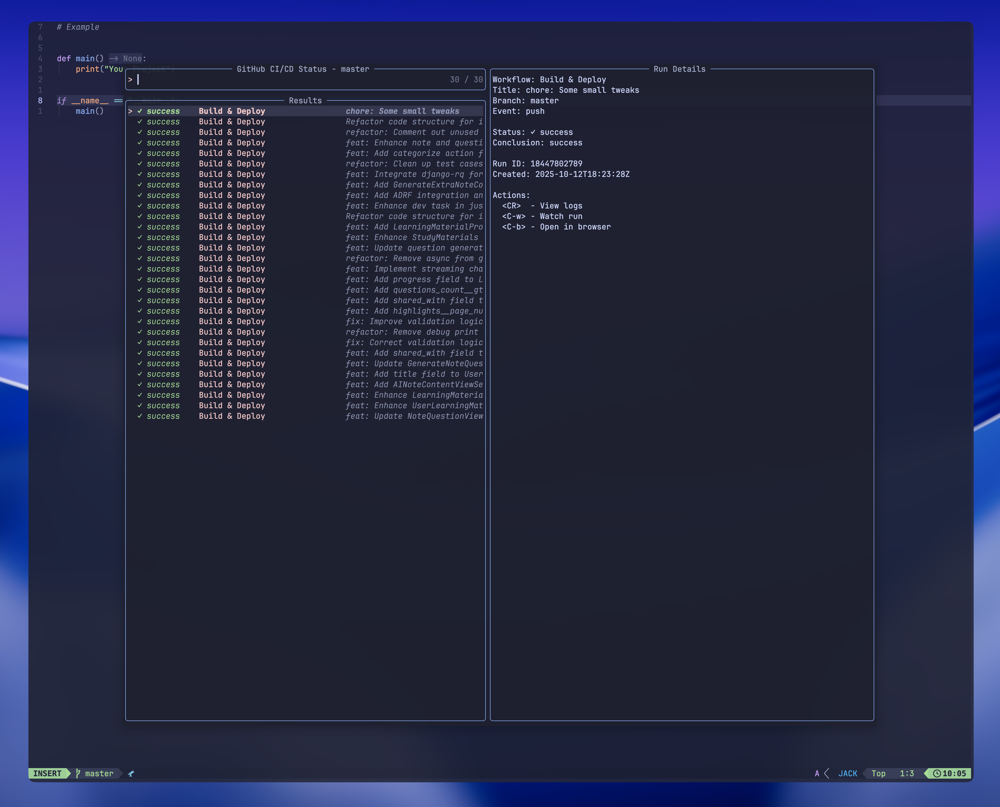

<p align="center">
  <h1 align="center">jaklimoff/github-actions.nvim</h2>
</p>

<p align="center">
    GitHub Actions at your fingertips
</p>



## ⚡️ Features

- 🔍 **Browse GitHub Actions runs** directly from Neovim
- 📊 **Real-time status updates** for CI/CD workflows
- 🎯 **Telescope integration** for beautiful, interactive UI
- ⚡ **Async operations** - non-blocking run fetching
- 🔎 **Run previews** with detailed information
- 🌐 **Quick actions**: view logs, watch runs, open in browser
- 🎨 **Visual indicators** for run status (success, failure, running, etc.)
- ⌨️ **Keyboard shortcuts** for fast workflow navigation

## 📋 Installation

### Prerequisites

- Neovim >= 0.7.0
- [GitHub CLI (`gh`)](https://cli.github.com/) - must be installed and authenticated
- [telescope.nvim](https://github.com/nvim-telescope/telescope.nvim) - for the picker UI
- [plenary.nvim](https://github.com/nvim-lua/plenary.nvim) - for async operations

### Package Managers

<details>
<summary><b>lazy.nvim</b> (recommended)</summary>

```lua
{
  "jaklimoff/github-actions.nvim",
  dependencies = {
    "nvim-telescope/telescope.nvim",
    "nvim-lua/plenary.nvim",
  },
  config = function()
    require("github-actions").setup({
      -- your configuration here
    })
  end,
}
```

</details>

<details>
<summary><b>packer.nvim</b></summary>

```lua
use {
  "jaklimoff/github-actions.nvim",
  requires = {
    "nvim-telescope/telescope.nvim",
    "nvim-lua/plenary.nvim",
  },
  config = function()
    require("github-actions").setup()
  end,
}
```

</details>

<details>
<summary><b>vim-plug</b></summary>

```vim
Plug 'nvim-telescope/telescope.nvim'
Plug 'nvim-lua/plenary.nvim'
Plug 'jaklimoff/github-actions.nvim'
```

</details>

## ☄ Getting started

### Quick Start

1. Make sure you have [GitHub CLI](https://cli.github.com/) installed and authenticated:

   ```bash
   gh auth login
   ```

2. Install the plugin with your package manager

3. Open a project with a GitHub repository

4. Run `:GithubActionsStatus` to see your CI/CD runs

### Basic Usage

```lua
-- Show CI/CD status for current branch
:GithubActionsStatus

-- Or use the Lua API
require("github-actions").show_ci_status()

-- With custom options
require("github-actions").show_ci_status({ limit = 30 })
```

### Keyboard Shortcuts (in Telescope picker)

| Key | Action |
|-----|--------|
| `<CR>` | View run logs in terminal |
| `<C-w>` | Watch run (live updates) |
| `<C-b>` | Open run in browser |
| `<C-l>` | View logs (alternative) |

## ⚙ Configuration

<details>
<summary>Click to unfold the full list of options with their default values</summary>

> **Note**: The options are also available in Neovim by calling `:h github-actions.options`

```lua
require("github-actions").setup({
  -- Enable debug logging
  debug = false,

  -- UI method to use for displaying CI status
  -- Currently only "telescope" is supported
  ui_method = "telescope",

  -- Maximum number of runs to fetch from GitHub Actions
  telescope_limit = 20,
})
```

</details>

### Example Configuration

```lua
-- With lazy.nvim
{
  "jaklimoff/github-actions.nvim",
  dependencies = {
    "nvim-telescope/telescope.nvim",
    "nvim-lua/plenary.nvim",
  },
  config = function()
    require("github-actions").setup({
      debug = false,
      telescope_limit = 30,
    })

    -- Optional: set up keybindings
    vim.keymap.set("n", "<leader>ga", "<cmd>GithubActionsStatus<cr>",
      { desc = "GitHub Actions Status" })
  end,
}
```

## 🧰 Commands

| Command | Description |
|---------|-------------|
| `:GithubActionsStatus` | Open Telescope picker with CI/CD runs for current branch |
| `:GithubActions` | Toggle the plugin |

## 🔌 API

The plugin exposes the following Lua API:

```lua
local gh = require("github-actions")

-- Show CI status picker
gh.show_ci_status()
gh.show_ci_status({ limit = 50 })

-- Direct run actions (requires run_id)
gh.view_run(12345)
gh.watch_run(12345)
gh.open_run_browser(12345)

-- Plugin lifecycle
gh.setup(opts)
gh.enable()
gh.disable()
gh.toggle()
```

## ⌨ Contributing

PRs and issues are always welcome. Make sure to provide as much context as possible when opening one.

## 🎯 Use Cases

- **Quick CI/CD checks** without leaving your editor
- **Monitor workflow progress** in real-time
- **Debug failed runs** by quickly accessing logs
- **Branch-specific workflow views** to track feature development
- **Reduce context switching** between terminal, browser, and editor

## 🤝 Dependencies

- [GitHub CLI](https://cli.github.com/) - for GitHub API interactions
- [telescope.nvim](https://github.com/nvim-telescope/telescope.nvim) - for the picker UI
- [plenary.nvim](https://github.com/nvim-lua/plenary.nvim) - for async operations

## 📝 License

MIT
